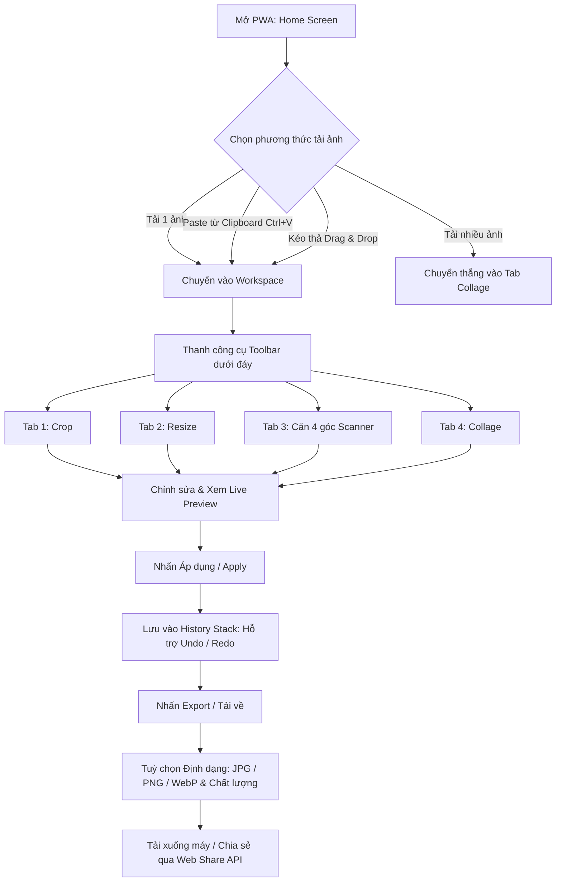

# TÀI LIỆU ĐẶC TẢ YÊU CẦU & THIẾT KẾ KỸ THUẬT (SRS & ARCHITECTURE)
## DỰ ÁN: PWA PIC COLLAGE & IMAGE TOOLKIT

---

## 1. TỔNG QUAN DỰ ÁN (PROJECT OVERVIEW)

### 1.1. Mục tiêu
Xây dựng một ứng dụng web dạng **Progressive Web App (PWA)** gọn nhẹ, hiện đại, chạy hoàn toàn **phía máy khách (100% Client-side / Offline-first)**. Ứng dụng cung cấp 4 công cụ xử lý ảnh thiết yếu hàng ngày mà không cần cài đặt phần mềm nặng hay tải ảnh lên máy chủ (đảm bảo quyền riêng tư tuyệt đối cho người dùng):
1. **Crop ảnh**: Cắt ảnh theo tỉ lệ chuẩn hoặc tự do với điều khiển chạm/kéo mượt mà.
2. **Resize ảnh**: Thay đổi kích thước theo phần trăm (%) hoặc giới hạn max-width / max-height mà không làm biến dạng tỉ lệ (aspect ratio).
3. **Căn ảnh 4 góc (Perspective Transform / Document Scanner)**: Chấm 4 điểm trên 4 góc của tài liệu/giấy tờ, tự động nắn thẳng góc nhìn thành hình chữ nhật phẳng.
4. **Collage ảnh**: Ghép nhiều ảnh theo dạng lưới (hàng x cột) linh hoạt với cấu hình tuỳ biến (spacing, margin, border radius, background color).

### 1.2. Đối tượng người dùng & Trường hợp sử dụng
- **Người dùng văn phòng / Học sinh - Sinh viên**: Chụp tài liệu, hoá đơn, CCCD bị nghiêng chéo -> Dùng tính năng Căn ảnh 4 điểm để biến thành bản scan phẳng đẹp mắt; crop và resize để nộp hồ sơ.
- **Bán hàng online / Content Creator**: Ghép ảnh sản phẩm vào collage lưới 2x2, 3x3, gắn viền đẹp mắt, crop tỉ lệ 1:1 cho Instagram/Shopee, 9:16 cho Story/TikTok.
- **Người dùng phổ thông**: Nhanh chóng giảm dung lượng ảnh, crop avatar, ghép ảnh kỷ niệm mà không sợ lộ thông tin cá nhân.

---

## 2. KIẾN TRÚC KỸ THUẬT & LỰA CHỌN CÔNG NGHỆ

### 2.1. Tech Stack chính thức (Approved Tech Stack)
- **Core Engine**: HTML5 Canvas API (Canvas 2D context) kết hợp WebGL shader (cho thuật toán Perspective Transform và Filters real-time).
- **Frontend Framework**: **Vanilla TypeScript + Vite** (Không dùng framework cồng kềnh như React/Vue để tối ưu tốc độ khởi động < 0.3s, dung lượng bundle < 150KB, chuẩn PWA không bloatware).
- **Styling**: Vanilla CSS (Modern CSS: CSS Custom Properties, Flexbox, CSS Grid, Backdrop-filter glassmorphism, Container Queries).
- **PWA Ecosystem**:
  - `manifest.webmanifest`: Khai báo icon, display mode `standalone`, shortcuts, Share Target API.
  - `sw.js` (Service Worker): Cache-first / Stale-While-Revalidate chiến lược, hỗ trợ offline 100%.
  - `File Handling API`: Cho phép bấm "Open With" trực tiếp từ trình quản lý file của hệ điều hành (Android, Windows, macOS).

```
+-----------------------------------------------------------------------+
|                             PWA Shell                                 |
|  [Header / Tab Switcher] [Workspace Canvas Viewport] [Toolbox Dock]  |
+-----------------------------------------------------------------------+
                                   |
         +-------------------------+-------------------------+
         |                         |                         |
+-----------------+       +-----------------+       +-----------------+
|  Crop Module    |       |  Resize Module  |       |  Scanner Module |
|  - Aspect ratios|       |  - Scale %      |       |  - 4-point pin  |
|  - Crop box UI  |       |  - Max W/H lock |       |  - Homography   |
|  - Rule-thirds  |       |  - Bicubic step |       |  - Paper filter |
+-----------------+       +-----------------+       +-----------------+
                                   |
                          +-----------------+
                          | Collage Module  |
                          | - Grid NxM      |
                          | - Cell Pan/Zoom |
                          | - Gaps/Margins  |
                          +-----------------+
                                   |
+-----------------------------------------------------------------------+
|                    Export & Processing Pipeline                       |
|   - Multi-step Canvas Scaling (Quality preservation)                  |
|   - WebGL Perspective Shader (Zero-dependency Homography Warp)        |
|   - WebP / JPEG / PNG Blob encoder & File System Access / Download   |
+-----------------------------------------------------------------------+
```

### 2.2. Nguyên tắc hiệu năng & Quản lý bộ nhớ (Large Images)
- Camera điện thoại ngày nay thường chụp ảnh 12MP - 48MP (kích thước 3000x4000 đến 6000x8000).
- Tránh vẽ trực tiếp ảnh 48MP lên màn hình gây lag hoặc giật khung hình:
  - **Display Canvas (Viewport)**: Render phiên bản thu nhỏ (preview scale) vừa vặn khung nhìn điện thoại/máy tính với tốc độ 60fps.
  - **Offscreen Processing Canvas**: Khi người dùng nhấn "Export" hoặc "Áp dụng", phép biến đổi được áp dụng chính xác lên toạ độ gốc (full-resolution coordinates) để chất lượng ảnh đầu ra đạt độ phân giải tối đa.

---

## 3. ĐẶC TẢ CHI TIẾT 4 CHỨC NĂNG CHÍNH

### 3.1. Chức năng 1: CROP ẢNH (Image Cropping)

#### A. Yêu cầu giao diện
- Khung xem trước ảnh (Interactive Viewport) có vùng tối xung quanh và vùng sáng ở giữa (khung cắt).
- Khung cắt có 8 điểm neo (4 góc + 4 cạnh giữa) và đường lưới tỉ lệ 1/3 (Rule of Thirds).
- Thao tác:
  - Kéo các điểm neo để điều chỉnh kích thước crop box.
  - Chạm/kéo bên trong crop box để di chuyển vị trí.
  - Hỗ trợ thao tác hai ngón tay (Pinch to zoom, pan) trên mobile.

#### B. Tỉ lệ cắt chuẩn (Aspect Ratio Presets)
- **Tự do (Free)**: Không khóa tỉ lệ, người dùng tự kéo theo ý muốn.
- **1:1**: Vuông (Avatar, Instagram Post, Shopee).
- **4:3 & 3:4**: Tỉ lệ ảnh chụp máy ảnh/điện thoại truyền thống, tài liệu ngang/dọc.
- **16:9 & 9:16**: Tỉ lệ màn hình rộng (YouTube thumbnail, màn hình máy tính) và Story/TikTok/Reels.
- **2:3 & 3:2**: Tỉ lệ in ảnh chuẩn (4x6 inch, 10x15 cm).
- **1:1.414 (A4 / ISO 216)**: Chuẩn văn bản in ấn.

#### C. Công cụ bổ trợ đi kèm
- **Xoay (Rotate)**: Xoay 90° cùng chiều / ngược chiều kim đồng hồ, lật ngang (Flip Horizontal), lật dọc (Flip Vertical).
- **Nắn góc thẳng (Straighten Slider)**: Thanh trượt tinh chỉnh góc nghiêng -45° đến +45°.

---

### 3.2. Chức năng 2: RESIZE ẢNH (Image Resizing)

#### A. Chế độ điều chỉnh kích thước
1. **Chế độ Phần trăm (Percentage %)**:
   - Presets nhanh: `25%`, `50%`, `75%`, `100%`, `150%`, `200%`.
   - Thanh trượt hoặc ô nhập số thực tế từ `1%` đến `500%`.
2. **Chế độ Kích thước Pixel (Dimensions W x H)**:
   - Hai ô nhập: Chiều rộng (Width) và Chiều cao (Height) tính bằng px.
   - Nút bật/tắt **"Khóa tỉ lệ" (Maintain Aspect Ratio)** (mặc định luôn BẬT):
     - Khi người dùng nhập Width -> Height tự động tính: `Height = Math.round(Width / originalRatio)`.
     - Khi người dùng nhập Height -> Width tự động tính: `Width = Math.round(Height * originalRatio)`.
3. **Chế độ Giới hạn Cạnh tối đa (Max Dimension Clamping)**:
   - Tuỳ chọn: "Max Width" (ví dụ: tối đa 1920px), "Max Height" (ví dụ: tối đa 1080px), hoặc "Max Edge" (Cạnh dài nhất không vượt quá X px).
   - Nếu ảnh gốc nhỏ hơn giới hạn, có tuỳ chọn giữ nguyên (không upscale gây mờ) hoặc ép phóng to.

#### B. Chất lượng nội suy (Resampling Quality)
- Áp dụng thuật toán **Multi-step Downscaling** (giảm kích thước nhiều lần từng bước một nửa) hoặc kích hoạt `ctx.imageSmoothingQuality = 'high'` để tránh hiện tượng răng cưa và mất chi tiết mảnh khi thu nhỏ ảnh từ 4000px xuống 800px.
- Dự đoán trước dung lượng file xuất ra (Estimated File Size).

---

### 3.3. Chức năng 3: CĂN ẢNH 4 GÓC / QUÉT TÀI LIỆU (Perspective Transform)

Đây là tính năng độc đáo và hữu ích nhất của ứng dụng: giải quyết bài toán chụp tài liệu, sách, bảng viết, CCCD bị chụp chéo góc, bóng mờ hoặc méo hình bình hành.

```
+-----------------------------+         +-----------------------------+
|    ẢNH CHỤP GÓC NGHIÊNG     |         |     KẾT QUẢ ĐÃ NẮN PHẲNG    |
|                             |         |                             |
|          P0(x0,y0)          |         | (0,0)               (W,0)   |
|            / \              |         |   +-------------------+     |
|           /   \ P1(x1,y1)   |  ===>   |   |                   |     |
|          /     \            |         |   |    TÀI LIỆU       |     |
|         /       \           |         |   |    VUÔNG VẮN      |     |
|  P3(x3,y3)------P2(x2,y2)   |         |   +-------------------+     |
|                             |         | (0,H)               (W,H)   |
+-----------------------------+         +-----------------------------+
```

#### A. Luồng tương tác người dùng
1. Tải ảnh chụp tài liệu lên màn hình.
2. Ứng dụng tự động hiển thị 4 điểm neo (Pins) kết nối thành một tứ giác màu dạ quang (Neon Cyan/Accent color):
   - Mặc định khởi tạo 4 điểm cách 4 góc biên 10% nếu chưa có nhận diện cạnh.
3. Người dùng chạm kéo 4 góc:
   - **Góc 1**: Trên - Trái (Top-Left)
   - **Góc 2**: Trên - Phải (Top-Right)
   - **Góc 3**: Dưới - Phải (Bottom-Right)
   - **Góc 4**: Dưới - Trái (Bottom-Left)
4. **Kính lúp phóng to (Magnifier Loupe)**:
   - Khi ngón tay/chuột đang đè lên một điểm neo, một vòng tròn kính lúp (zoom 2.5x) hiển thị phía trên ngón tay để người dùng thấy rõ mép góc tài liệu dưới đầu ngón tay mà không bị che khuất.
5. Xem trước (Preview) tức thời và nhấn "Nắn ảnh / Warp".

#### B. Thuật toán kỹ thuật & Các preset khổ đầu ra (Perspective Homography Warp)
- Tính toán ma trận biến đổi phối cảnh 3x3 ($H$) từ 4 điểm nguồn $(x_i, y_i)$ sang 4 điểm đích chữ nhật $(0,0), (W,0), (W,H), (0,H)$.
- **Các chế độ xác định kích thước chữ nhật đích (Output Dimensions & Presets)**:
  1. **Tự động (Auto Detect / Natural Ratio - Mặc định)**:
     - Tự động đo khoảng cách thực tế của các cạnh được chọn để giữ nguyên tỉ lệ vật thể:
       $$W = \max(\text{distance}(P_0, P_1), \text{distance}(P_3, P_2))$$
       $$H = \max(\text{distance}(P_0, P_3), \text{distance}(P_1, P_2))$$
  2. **Preset Khổ A4 (ISO 216)**:
     - **A4 Dọc (Portrait)**: Tỉ lệ chuẩn $1 : \sqrt{2} \approx 1 : 1.414$ (Phù hợp tài liệu, hợp đồng, giấy tờ học tập).
     - **A4 Ngang (Landscape)**: Tỉ lệ chuẩn $\sqrt{2} : 1 \approx 1.414 : 1$.
  3. **Preset Thẻ căn cước / CCCD / Namecard (Chuẩn ISO/IEC 7810 ID-1)**:
     - Tỉ lệ chuẩn $85.60 \text{ mm} \times 53.98 \text{ mm} \approx 1.586 : 1$ (hoặc đảo ngược $1 : 1.586$ nếu chụp dọc).
     - Giúp căn phẳng thẻ ngân hàng, căn cước công dân, bằng lái xe chuẩn xác không bị bẹp hay kéo dài.
  4. **Preset Hoá đơn / Receipt dài**:
     - Tỉ lệ dọc $1 : 2$ hoặc $1 : 2.5$ cho hoá đơn siêu thị, phiếu thu, bill thanh toán.
  5. **Tỉ lệ ảnh gốc (Keep Source Ratio)**:
     - Khóa theo tỉ lệ khung hình của bức ảnh gốc chụp ban đầu.
- **Thực thi render không phụ thuộc thư viện nặng**:
  - Dùng **WebGL Fragment Shader** (chỉ tốn ~2KB code JS) để thực hiện texture inverse mapping trên GPU cực nhanh (<16ms cho ảnh 4K), hoặc fallback sang Canvas 2D Subdivision mesh nếu thiết bị không hỗ trợ WebGL.
  - Không cần cài OpenCV.js cồng kềnh (vốn nặng 8MB - 12MB, rất tệ cho PWA).

#### C. Bộ lọc cải thiện văn bản (Document Enhancement Filters)
Sau khi nắn thẳng, người dùng có thể áp dụng 1 chạm:
- **Nguyên bản (Original)**: Giữ màu gốc.
- **Magic Scan / B&W Document**: Tự động tăng độ tương phản, làm trắng nền giấy, làm đen mực chữ (thuật toán Adaptive Thresholding).
- **Grayscale**: Chuyển ảnh xám sạch sẽ.
- **Tăng sáng / Contrast**: Thanh trượt thủ công.

---

### 3.4. Chức năng 4: COLLAGE ẢNH / GHÉP ẢNH LƯỚI (Photo Grid & Collage)

#### A. Thiết lập bố cục lưới (Grid Settings)
- **Số hàng (Rows) & Số cột (Columns)**:
  - Chọn nhanh bố cục thông dụng: `1x2`, `2x1`, `2x2`, `3x2`, `2x3`, `3x3`, `1+2` (1 ảnh lớn bên trái, 2 ảnh nhỏ bên phải).
  - Tự do tăng giảm số hàng (1 đến 6) và số cột (1 đến 6).
- **Khoảng cách & Căn lề**:
  - **Outer Margin**: Khoảng trống từ mép ngoài canvas vào lưới ảnh (0px đến 100px).
  - **Grid Gap / Spacing**: Khoảng cách rãnh giữa các ảnh trong lưới (0px đến 50px).
  - **Border Radius**: Bo góc từng khung ảnh (0px đến 60px).
- **Tỉ lệ khung tổng thể (Canvas Aspect Ratio)**:
  - 1:1 (Vuông), 4:5 (Instagram portrait), 16:9, 9:16, 4:3, A4.
- **Màu nền (Background Styling)**:
  - Màu đơn sắc (Bảng màu có sẵn + Color Picker mã HEX/RGBA).
  - Nền mờ nghệ thuật (Blur background từ chính các bức ảnh).
  - Nền trong suốt (Transparent PNG).

#### B. Tương tác với từng ô ảnh (Cell Interaction)
- **Kéo thả / Hoán đổi**: Kéo ảnh từ ô này thả sang ô khác để đổi vị trí (Swap).
- **Pan & Zoom trong ô**: Nhấp đôi hoặc chọn ô ảnh để phóng to/thu nhỏ và di chuyển khung hình bên trong ô mà không làm méo tỉ lệ ô.
- **Xoay ảnh con**: Xoay riêng lẻ bức ảnh trong ô 90°.
- **Thay thế / Xoá**: Nút bấm nhanh trên từng ô để đổi ảnh khác hoặc xoá ô.

---

## 4. LUỒNG TRẢI NGHIỆM NGƯỜI DÙNG (USER EXPERIENCE FLOW)



### 4.1. Hệ thống Undo / Redo (Lịch sử thao tác)
- Quản lý trạng thái bằng một mảng Snapshot lịch sử (tối đa 10 bước gần nhất để tiết kiệm RAM).
- Mỗi snapshot lưu trạng thái ảnh đã áp dụng (hoặc ImageData/OffscreenCanvas).
- Cho phép người dùng bấm `Ctrl+Z` (Undo) hoặc `Ctrl+Y` (Redo) bất cứ lúc nào.

---

## 5. THIẾT KẾ GIAO DIỆN & TỐI ƯU GIAO DIỆN NGƯỜI DÙNG (UI/UX)

### 5.1. Triết lý thiết kế: Light Theme duy nhất (Clean Studio Aesthetic)
- **Chỉ hỗ trợ Light Theme (Light Mode Only)**:
  - Giao diện được thiết kế chuyên biệt cho nền sáng, mang phong cách tối giản Bắc Âu (Minimal Nordic / Clean Studio).
  - **Màu nền (Backgrounds)**: Nền trang chính màu trắng tinh khiết (`#ffffff`), vùng làm việc canvas (`.canvas-workspace`) sử dụng tông xám nhẹ êm mắt (`#f8fafc` hoặc `#f1f5f9`), có tùy chọn nền lưới bàn cờ (checkerboard) xám nhạt để dễ dàng nhận biết vùng ảnh trong suốt khi xuất PNG.
  - **Đường nét & Phân tách (Borders)**: Sử dụng các đường viền mỏng tinh tế (`#e2e8f0` / `#cbd5e1`), tạo phân vùng rõ ràng giữa các thanh công cụ, bảng điều khiển và vùng ảnh.
  - **Typography & Tương phản**: Phông chữ không chân hiện đại (Inter / Plus Jakarta Sans). Màu chữ chính Deep Slate (`#0f172a`), màu chữ phụ (`#64748b`), đảm bảo tỷ lệ tương phản đạt chuẩn WCAG AA $\ge 4.5:1$.
  - **Hiển thị số liệu (Tabular Nums)**: Sử dụng CSS `font-variant-numeric: tabular-nums` cho tất cả kích thước pixel (W x H), phần trăm zoom/resize và góc xoay để tránh co giật giao diện khi giá trị thay đổi.

### 5.2. Nhận diện thương hiệu & Icon App (Cyan & Tím)
- **Background Icon ứng dụng**:
  - Sử dụng dải chuyển màu gradient mượt mà kết hợp giữa **2 màu Cyan (Xanh ngọc)** và **Tím (Purple / Violet)**:
    $$\text{Background} = \text{linear-gradient}(135^\circ, \, \#06b6d4 \text{ [Cyan]} \,\, 0\%, \, \#8b5cf6 \text{ [Purple]} \,\, 100\%)$$
  - Biểu tượng trung tâm màu trắng sáng đồ hoạ sắc nét đại diện cho công cụ xử lý ảnh (khung cắt & lưới ảnh đa năng).
  - Cung cấp đầy đủ icon kích thước: `192x192`, `512x512`, `apple-touch-icon.png` và **Maskable Icon** với safe-zone 80% (không bị cắt lẹm khi Android bo tròn/vuông).
- **Điểm nhấn giao diện (Accents & Controls)**:
  - Các nút hành động chính (Apply, Export), thanh active tab, các điểm neo chấm tròn (pins) và đường viền crop box sử dụng sắc màu Cyan (`#06b6d4`) và Tím (`#8b5cf6`), tạo điểm nhấn nổi bật, rực rỡ và bắt mắt trên nền giao diện trắng sáng.
  - Thanh Dock công cụ và Header áp dụng hiệu ứng kính mờ nền sáng (Light Glassmorphism: `background: rgba(255, 255, 255, 0.85); backdrop-filter: blur(16px); border: 1px solid rgba(226, 232, 240, 0.8)`).

### 5.3. Bố cục giao diện Responsive & Safe Area

#### Trên Thiết bị Di động (Mobile First):
- **Top App Bar**:
  - Đồng bộ `background-color: #ffffff`.
  - Áp dụng `padding-top: env(safe-area-inset-top)` và `height: calc(56px + env(safe-area-inset-top))` để mở rộng tự nhiên qua tai thỏ mà không có viền `border-top` hoặc `box-shadow` ở đỉnh (tránh tạo vết cắt trên iOS).
  - Tích hợp: Tên app + Nút **Update App** (`#btnUpdateApp`) + Nút **Cài đặt** (`#btnInstall`) + Nút **Undo/Redo** + Nút **Export**.
- **Center Canvas Viewport**:
  - Khung xem trước chiếm phần lớn diện tích màn hình (65% - 70%), hỗ trợ thao tác kéo, cuộn, hai ngón tay (pinch-to-zoom).
- **Contextual Option Panel**:
  - Thanh trượt, nút chọn tỉ lệ, màu sắc bố trí ngay phía trên ngón tay cái, dễ dàng thao tác một tay.
- **Bottom Navigation Dock**:
  - Thanh điều hướng 4 chức năng cốt lõi (Crop, Resize, Căn 4 góc, Collage).
  - Tích hợp `padding-bottom: env(safe-area-inset-bottom)` để không bị thanh vuốt Home của iOS / Android che khuất.
- **Vùng chạm (Touch Target)**:
  - Mọi nút bấm, icon button, điểm neo đều đạt kích thước tối thiểu **44×44 px** (nút hành động chính đạt **48×48 px**).

#### Trên Máy tính (Desktop / Tablet):
- Màn hình rộng tận dụng không gian với khung canvas lớn ở trung tâm và bảng điều khiển chi tiết (Side Panel) ở bên phải.

---

## 6. TIÊU CHUẨN PWA QUỐC TẾ & TÍNH NĂNG OFFLINE (PWA STANDARDS COMPLIANCE)

Ứng dụng tuân thủ nghiêm ngặt và đầy đủ 100% bộ quy chuẩn **Global Rule: PWA Standards & Mobile Best Practices**:

### 6.1. Cấu hình Web App Manifest (`manifest.webmanifest`)
- **App ID (`id`)**: BẮT BUỘC khai báo `"id": "/pwa-pic-collage/"` (định danh theo subpath repository để tương thích tuyệt đối khi host trên GitHub Pages hoặc domain dùng chung, triệt tiêu hoàn toàn lỗi WebAPK *"App already installed"* hoặc mất nút cài đặt).
- **Scope & Start URL**: `"scope": "./"`, `"start_url": "./"` (đảm bảo mở app đúng thư mục gốc).
- **Tên ứng dụng**: `"name": "PicStudio - Chỉnh Sửa & Ghép Ảnh"`, `"short_name": "PicStudio"`.
- **Display & Orientation**: `"display": "standalone"`, `"orientation": "any"`.
- **Màu sắc Light Theme**:
  - `"theme_color": "#ffffff"` (đồng bộ với màu thanh trạng thái và header nền sáng).
  - `"background_color": "#ffffff"` (màu nền splash screen khi khởi chạy app).
- **Icons**: Đầy đủ `icon-192.png`, `icon-512.png`, `maskable-icon.png` nền gradient Cyan-Tím với `"purpose": "any maskable"`.

### 6.2. Tương thích iOS Safari (iOS Meta Tags & Tránh Gradient Scrim)
Trong thẻ `<head>` của `index.html`:
```html
<meta name="viewport" content="width=device-width, initial-scale=1.0, viewport-fit=cover">
<meta name="apple-mobile-web-app-capable" content="yes">
<!-- BẮT BUỘC dùng content="default" cho Light Theme nền trắng (#ffffff), TUYỆT ĐỐI KHÔNG dùng black-translucent để tránh dải đen gradient lem luốc trên đỉnh màn hình iOS -->
<meta name="apple-mobile-web-app-status-bar-style" content="default">
<meta name="apple-mobile-web-app-title" content="PicStudio">
<link rel="apple-touch-icon" href="./icons/icon-192.png">
```

### 6.3. Tắt Pull-to-Refresh & Nút "Update App" (Force Update)
1. **Tắt Pull-to-Refresh mặc định của trình duyệt**:
   - Tránh hiện tượng vuốt xuống khi đang chỉnh ảnh làm trình duyệt tự tải lại trang và làm mất ảnh trong bộ nhớ:
     ```css
     html, body {
       overscroll-behavior-y: none; /* Vô hiệu hóa pull-to-refresh và hiệu ứng nảy rubber-band */
     }
     ```
2. **Nút "Update App" (`#btnUpdateApp`) trên Top App Bar**:
   - Thay thế việc vuốt pull-to-refresh bằng nút bấm kiểm tra cập nhật chủ động:
     - Khi bấm: kiểm tra `navigator.onLine`, hiển thị spinner `"Updating..."`.
     - Gọi `registration.update()`, nếu có worker mới gửi `{ action: 'skipWaiting' }`.
     - Xóa cache cũ (`caches.delete()`) và unregister SW cũ để ép tải bản mới nhất.
     - Tự động nạp lại ứng dụng an toàn với timestamp bypass.
   - Khi SW phát hiện cập nhật trong nền: nút tự chuyển sang trạng thái viền sáng nhấp nháy `"Update Ready"` kèm thông báo Snackbar.

### 6.4. Quản lý Sự kiện Cài đặt PWA & Nút Cài đặt (Install Button Pattern)
- Nút **"Cài đặt" (`#btnInstall`)** đặt trên Top App Bar, mặc định có class `hidden` trong HTML.
- **Kiểm tra Standalone**: Nếu `isStandalone === true` (`window.matchMedia('(display-mode: standalone)').matches || window.navigator.standalone === true`), **TUYỆT ĐỐI KHÔNG** hiển thị nút.
- **Android / Desktop**: Bắt sự kiện `beforeinstallprompt`, lưu `deferredPrompt`, hiển thị nút `#btnInstall` và kích hoạt khi người dùng nhấn.
- **iOS Safari**: Không có `beforeinstallprompt`, nếu phát hiện đang mở trong trình duyệt Safari (chưa cài standalone) -> hiển thị nút `#btnInstall`. Khi bấm sẽ mở **Hộp thoại / Bottom Sheet hướng dẫn "Thêm vào Màn hình chính" (Add to Home Screen)** chi tiết bằng tiếng Việt.

### 6.5. Cô lập Scope Service Worker & Chiến lược Offline 100%
- Đăng ký Service Worker với scope tương đối:
  ```javascript
  navigator.serviceWorker.register('./sw.js', { scope: './' });
  ```
- **Fetch Safety & Scope Isolation**: Không chặn hoặc can thiệp vào request của ứng dụng khác trên cùng domain:
  ```javascript
  if (requestUrl.origin === self.location.origin && !event.request.url.startsWith(self.registration.scope)) {
    return; // Bỏ qua, để trình duyệt xử lý mạng bình thường
  }
  ```
- Bỏ qua các request không phải `GET`, hoặc giao thức `blob:`, `data:`, `chrome-extension:`.
- Toàn bộ danh sách `PRECACHE_ASSETS` sử dụng đường dẫn tương đối (`./index.html`, `./src/main.ts`, v.v.).
- **Cache-Busting & Versioning**:
  - Gắn query string `?v=X` vào các liên kết assets trong `index.html`.
  - Tăng `CACHE_NAME` (`picstudio-v1`) mỗi khi cập nhật, sử dụng `caches.match(event.request, { ignoreSearch: true })` và tự động dọn sạch cache cũ trong sự kiện `activate`.
  - Không phụ thuộc vào CDN bên ngoài (100% self-contained), đảm bảo vượt qua kiểm tra **"Airplane Mode"** (hoạt động offline trơn tru không cần mạng).

### 6.6. Xử lý Tải File & Mobile Web Share API
- Khi người dùng xuất ảnh:
  - **Android / Desktop Chrome**: Tạo thẻ `<a download="picstudio-output.webp" href="blobUrl">`, kích hoạt click và xóa thẻ.
  - **iOS Safari**: Tránh mở trang trắng xem trước. Kiểm tra hỗ trợ:
    ```javascript
    if (navigator.canShare && navigator.canShare({ files: [file] })) {
      await navigator.share({
        files: [new File([blob], fileName, { type: blob.type })],
        title: 'PicStudio Image',
      });
    }
    ```
    Cho phép người dùng chọn trực tiếp **"Lưu hình ảnh" (Save Image)** hoặc **"Lưu vào Tệp" (Save to Files)**.
  - Luôn thu hồi URL sau khi sử dụng bằng `URL.revokeObjectURL(url)` để tránh rò rỉ bộ nhớ (memory leak).

### 6.7. Giữ sáng màn hình (Screen Wake Lock API) & a11y
- Sử dụng `navigator.wakeLock.request('screen')` khi thực hiện các tác vụ tính toán ma trận hoặc ghép ảnh độ phân giải cao, tự động giải phóng trong `finally`.
- Đảm bảo toàn bộ icon button có `aria-label`, dialog có `role="dialog"`, `aria-modal="true"`, focus trap và cho phép đóng bằng phím `Escape`.

---

## 7. CẤU TRÚC THƯ MỤC DỰ ÁN ĐỀ XUẤT

```
pwa-pic-collage/
├── index.html                   # Trang chủ duy nhất (SPA Shell)
├── manifest.webmanifest         # Cấu hình PWA Manifest
├── sw.js                        # Service Worker quản lý offline cache
├── package.json                 # Cấu hình dự án & Vite build tool
├── tsconfig.json                # Cấu hình TypeScript
├── public/
│   ├── favicon.ico
│   ├── icons/
│   │   ├── icon-192.png
│   │   ├── icon-512.png
│   │   └── maskable-icon.png
│   └── sample-images/           # Ảnh mẫu để người dùng thử nghiệm nhanh
└── src/
    ├── main.ts                  # Entry point, router tab & event binding
    ├── styles/
    │   ├── variables.css        # Hệ thống màu sắc, spacing, typography tokens
    │   ├── main.css             # Layout chung, canvas viewport, dark theme
    │   ├── components.css       # Buttons, sliders, tabs, modals, badges
    │   └── tools.css            # Style riêng cho crop box, pins, grid overlay
    ├── core/
    │   ├── CanvasManager.ts     # Quản lý viewport, zoom, pan, render loop
    │   ├── HistoryManager.ts    # Quản lý Undo / Redo state
    │   └── ImageExporter.ts     # Xuất ảnh (JPEG, PNG, WebP) và nén chất lượng
    ├── modules/
    │   ├── crop/
    │   │   ├── CropEngine.ts    # Logic toạ độ cắt, tỉ lệ cố định
    │   │   └── CropUI.ts        # Tương tác kéo 8 điểm neo, rule-of-thirds
    │   ├── resize/
    │   │   ├── ResizeEngine.ts  # Logic tính toán kích thước, khóa aspect ratio
    │   │   └── ResizeUI.ts      # Giao diện % và W x H
    │   ├── scanner/
    │   │   ├── PerspectiveWarp.ts # Thuật toán ma trận 3x3 Homography (WebGL/Canvas)
    │   │   ├── ScannerUI.ts       # Tương tác kéo 4 góc + Kính lúp phóng to
    │   │   └── DocumentFilter.ts  # B&W, Contrast, Clean paper filter
    │   └── collage/
    │       ├── CollageEngine.ts   # Tính toán toạ độ ô NxM, khoảng cách, căn lề
    │       └── CollageUI.ts       # Kéo thả đổi vị trí ảnh, tùy biến giao diện lưới
    └── utils/
        ├── math.ts              # Khoảng cách điểm, vector, tỉ lệ
        ├── dom.ts               # Helper DOM query & events
        └── pwa.ts               # Đăng ký Service Worker & bắt sự kiện Install Prompt
```

---

## 8. LỘ TRÌNH TRIỂN KHAI (IMPLEMENTATION ROADMAP)

Dự án được chia làm 4 giai đoạn cụ thể:

### Giai đoạn 1: Nền tảng PWA & Khung Canvas (Core Foundation)
- Khởi tạo dự án với Vite + TypeScript + Vanilla CSS.
- Xây dựng Layout Clean Light Studio hiện đại, tối ưu mobile-first & desktop.
- Thiết kế hệ thống icon PWA nền gradient Cyan & Tím đạt chuẩn maskable và iOS touch icon.
- Xây dựng `CanvasManager` (hỗ trợ kéo, cuộn chuột zoom, touch pinch-to-zoom).
- Tích hợp tải ảnh (File picker, Drag & Drop, Paste clipboard `Ctrl+V`).
- Xây dựng hệ thống `HistoryManager` (Undo / Redo).
- Thiết lập khung PWA: manifest `id: "/pwa-pic-collage/"`, Service Worker, nút Update App và nút Install App.

### Giai đoạn 2: Phát triển Chức năng Cắt (Crop) & Đổi cỡ (Resize)
- Hoàn thiện module Crop: Các tỉ lệ 1:1, 4:3, 16:9, A4; xoay ảnh 90°, lật ảnh.
- Hoàn thiện module Resize: Thay đổi theo %, nhập kích thước WxH có khóa tỉ lệ, chất lượng đa bước (multi-step downscale).

### Giai đoạn 3: Phát triển Chức năng Căn 4 góc (Perspective Scanner)
- Xây dựng bộ điều khiển 4 điểm neo có kính lúp phóng to (Magnifier Loupe) khi kéo.
- Lập trình thuật toán ma trận phối cảnh Homography bằng WebGL Fragment Shader hoặc Canvas 2D math (nhẹ, nhanh, không cần thư viện bên ngoài).
- Thêm bộ lọc tài liệu đơn sắc (Clean Scan / B&W / High Contrast).

### Giai đoạn 4: Phát triển Chức năng Ghép ảnh (Collage Grid) & Tối ưu PWA
- Xây dựng lưới ghép ảnh tùy biến: số hàng, số cột, margin, gap, bo góc, màu nền.
- Hỗ trợ đổi ảnh, pan/zoom từng ô ảnh trong collage.
- Cấu hình PWA hoàn chỉnh: Service Worker offline caching, Web App Manifest, Install Banner.
- Tối ưu hiệu năng, kiểm thử trên các kích thước màn hình và thiết bị thực tế.

---

## 9. CÁC QUYẾT ĐỊNH THIẾT KẾ ĐÃ THỐNG NHẤT (APPROVED DESIGN DECISIONS)

Dưới đây là các quyết định kỹ thuật và tính năng đã được thống nhất chính thức để tiến hành triển khai:

| Hạng mục | Quyết định kỹ thuật đã phê duyệt |
| :--- | :--- |
| **Giao diện & Theme** | **Chỉ hỗ trợ Light Theme (Light Mode Only)**.<br>- Tông màu trắng chủ đạo (`#ffffff`), vùng làm việc xám nhẹ (`#f8fafc`).<br>- Chữ tương phản cao Deep Slate (`#0f172a`), đạt chuẩn WCAG AA $\ge 4.5:1$.<br>- Tabular nums cho số liệu pixel, %, góc xoay.<br>- Không hỗ trợ Dark Mode. |
| **Bản sắc & Icon App** | **Background Gradient Cyan & Tím**:<br>- Phối màu gradient `linear-gradient(135deg, #06b6d4, #8b5cf6)`.<br>- Biểu tượng trắng trung tâm sắc nét, phong cách đồ họa hiện đại.<br>- Cung cấp đầy đủ icon 192x192, 512x512, maskable icon (safe-zone 80%) và apple-touch-icon. |
| **Quy chuẩn PWA Toàn cầu (PWA Standards)** | **Tuân thủ 100% `pwa-standards.md`**:<br>1. **App ID**: Bắt buộc `"id": "/pwa-pic-collage/"` chống xung đột WebAPK trên GitHub Pages / subpath.<br>2. **iOS Safari**: `<meta name="apple-mobile-web-app-status-bar-style" content="default">` (tránh gradient scrim lem luốc trên nền sáng), safe-area insets.<br>3. **Chống reload mất ảnh**: `overscroll-behavior-y: none` trên `html, body` (tắt pull-to-refresh).<br>4. **Nút Update App**: Bố trí `#btnUpdateApp` trên Top App Bar hỗ trợ Force Update có kiểm soát.<br>5. **Nút Install App**: Bố trí `#btnInstall` (mặc định hidden), tự ẩn khi standalone, kèm modal hướng dẫn cho iOS Safari.<br>6. **Scope Isolation**: Service worker đăng ký `./sw.js` scope `./`, không can thiệp app khác, precache đường dẫn tương đối, cache-busting `?v=X`.<br>7. **Web Share API**: Hỗ trợ chia sẻ file trực tiếp trên iOS để người dùng chọn "Lưu vào Tệp" (Save to Files).<br>8. **Memory & Performance**: Tự động thu hồi `URL.revokeObjectURL(url)` và giữ màn hình sáng với Screen Wake Lock API khi xử lý ảnh lớn. |
| **Công nghệ nền tảng (Tech Stack)** | **Vanilla TypeScript + Vite + Vanilla CSS**.<br>Không sử dụng các framework UI nặng như React/Vue để đảm bảo ứng dụng đạt tiêu chuẩn PWA cao nhất: dung lượng bundle cực nhỏ (<150KB), nạp tức thì (<0.3s), không bloatware, hoàn toàn làm chủ Canvas 2D/WebGL rendering. |
| **Preset khổ đầu ra cho Căn ảnh 4 góc** | Hệ thống cung cấp đầy đủ các chế độ:<br>1. **Tự động (Auto Detect)**: Giữ nguyên tỉ lệ tự nhiên đo được từ 4 điểm neo.<br>2. **Khổ A4 (Dọc & Ngang)**: Chuẩn ISO 216 ($1 : \sqrt{2}$) cho tài liệu scan.<br>3. **Khổ Thẻ / CCCD / Namecard**: Chuẩn ISO/IEC 7810 ID-1 ($85.6 \times 53.98\text{ mm} \approx 1.586 : 1$).<br>4. **Khổ Hoá đơn (Receipt)**: Tỉ lệ dài $1 : 2$ hoặc $1 : 2.5$.<br>5. **Tỉ lệ ảnh gốc (Source Image Ratio)**. |
| **Bố cục Ghép ảnh (Collage Grid)** | Hỗ trợ lưới đối xứng linh hoạt từ $1 \times 2$ đến $4 \times 4$, tuỳ biến số hàng, số cột, padding, gap, border-radius và các layout bất đối xứng thông dụng (1 lớn + 2 nhỏ, 1 trên + 2 dưới). |
| **Định dạng xuất file** | Hỗ trợ 3 định dạng: **WebP** (mặc định - nén tối ưu nhất cho web), **JPEG** (kèm thanh trượt chất lượng % cho văn bản/ảnh chụp), **PNG** (ảnh nét không nén mất dữ liệu / hỗ trợ trong suốt). |

---
*Tài liệu đặc tả đã hoàn thiện và được phê duyệt để bắt đầu giai đoạn lập trình dự án.*
